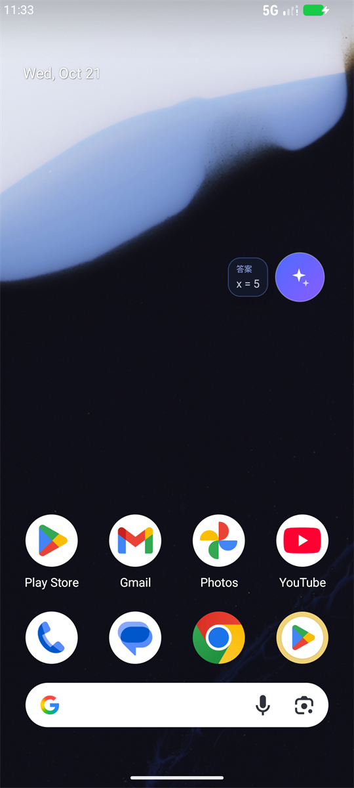
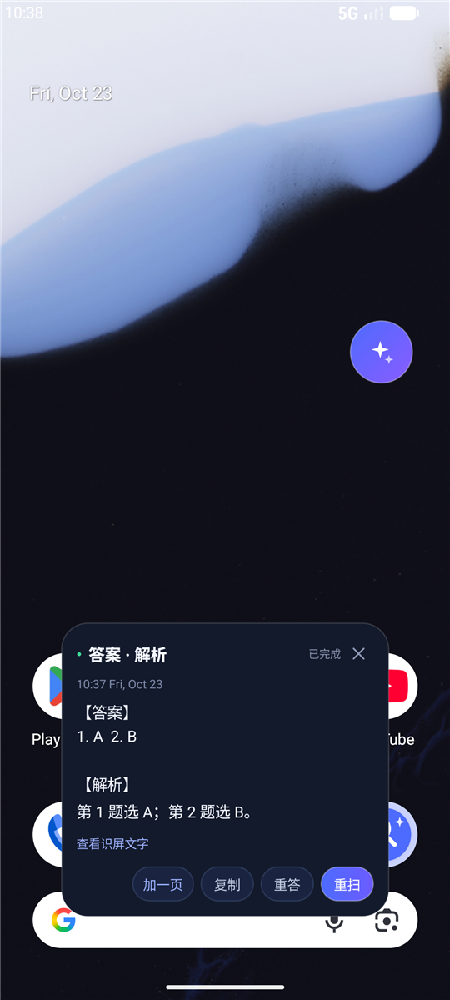

# 识屏答题助手（ScreenAnswer）v1.5.1

[](https://github.com/pgyz710/ScreenAnswer/actions/workflows/build-apk.yml)

一个 Android 悬浮窗小工具：点一下悬浮球，自动读取当前屏幕、在本地识别文字，再调用 DeepSeek 生成答案。**答案直接显示在悬浮球旁边**，想看解析再点一下悬浮球打开弹窗。支持多页试卷、英语模式和「听一段」语音输入。

> **v1.1.0 起不再使用屏幕共享 / 录屏（MediaProjection）**，改为通过 Android 无障碍服务的截图能力读取屏幕，不会出现系统「开始共享屏幕」的确认框，也没有持续录屏提示。
>
> 截图只在手机本地做 OCR，不会上传；只有识别出的文字会发送给 DeepSeek。

## 界面

| 答案直接显示在悬浮球旁 | 点一下球查看「答案 · 解析」 |
| --- | --- |
|  |  |

## 下载 / 安装

- 最新安装包：[Releases · v1.5.1](https://github.com/pgyz710/ScreenAnswer/releases/tag/v1.5.1)
- 自己构建：[GitHub Actions](https://github.com/pgyz710/ScreenAnswer/actions/workflows/build-apk.yml) 的 Artifacts，或本地 `./gradlew assembleDebug`

## v1.5.1 更新

- **英语题改为「答案英文 + 解析中文」**：`Answer:` 段保持英文（选项字母 + 英文选项原文），`Explanation:` 段用中文讲清楚原因，方便对照着看。
- 原来的「同语言作答」规则移除；英语模式下不再整段英文解析。
- 只影响英语模式，中文模式不变。

## v1.5.0 更新

- **英语模式**：App 首页的「识别语言」选 **English**。
  - 使用 ML Kit 拉丁 OCR 模型（以前只有中文模型，英文单词和选项字母容易认错）；
  - 提示词切换为英语版本，要求逐题核对选项字母，不允许编造选项；
  - 语音「听一段」也会用英文识别（en-US）。
- **两栏排版修复**：自动检测页面中间的白缝，把左右两栏切开分别 OCR，再按「左栏从上到下、右栏从上到下」拼接。以前两栏英语卷的同一行会被合成一行，题目和选项全串位。
- **「听一段」语音输入**：面板里新增按钮，用 Android 系统语音识别（不需要额外 Key），说完把识别文字作为一页参与作答。依赖手机自带的识别服务；如果提示网络错误/不可用，可以改用系统「实时字幕」或等后续接云转写。
- 英语模式下 `deepseek-reasoner` 通常比 `deepseek-chat` 更适合阅读理解和完形填空。

## v1.4.0 更新

- **多页收集**：一份试卷有多页时，扫完第 1 页后打开弹窗点「加一页」→ 翻到下一页 → 再点悬浮球，App 会把 2、3… 页拼在一起重新作答，弹窗状态显示「已完成 · N 页」。
- 多页时答案和解析都按题号顺序给出，跨页的同一道题会合并理解。
- 长按悬浮球仍然是「清空重来」：会丢掉已收集的页，从当前屏幕重新开始。
- 面板顶部的识屏预览改为显示刚扫的那一页；「查看识屏文字」里能看到全部页。
- 提示词更新：明确要求多页/多题按题号回答，「答案」只放结果、「解析」放推理。

### 听力题怎么办？

DeepSeek 只接收文字，App 本身不能“听”音频。可行的做法是用系统的**实时字幕**把声音转成屏幕文字，再让悬浮球去扫：

1. 打开手机 设置 → 无障碍 → **实时字幕 / Live Caption**（Android 12+，HyperOS 一般在「无障碍 → 听觉」里）。
2. 播放听力音频，字幕会浮在屏幕上。
3. 点悬浮球扫描字幕文字，DeepSeek 会根据听到的内容作答。

注意：实时字幕的英文支持通常好于中文；字幕有延迟，最好在放音前就打开；DRM/部分受保护音频可能无法转写。

如果以后需要“麦克风听外放 + 语音转写”，那要接额外的语音识别 API（Whisper、讯飞等），本版本没有做。

## v1.3.0 更新

- **答案和解析分开**：DeepSeek 按「答案：」「解析：」两段输出，App 自动拆开。
- **答案直接显示在悬浮球旁边**：一个小气泡跟着球走，只显示最终答案，最多 4 行，不遮挡大半个屏幕。
- **解析按需查看**：点一下悬浮球才打开弹窗，弹窗里是「【答案】+【解析】」的完整内容。
- **手势调整**：
  - 点悬浮球：没有答案时开始识屏；已有答案时打开解析弹窗；弹窗打开时再点一下收起。
  - **长按悬浮球**：重新识屏（换题后不用先打开弹窗）。
  - 双击悬浮球：隐藏悬浮球（和 v1.2.x 一样，不弹底部提示）。
- 关闭弹窗不再中断正在进行的请求；答案会继续流式写入球旁边的气泡。
- 识屏/思考过程也先显示在球旁边的气泡里（「识屏中…」「思考中…」→ 实时答案）。

## v1.2.1 更新

- 双击隐藏悬浮球时不再弹出底部 Toast（原来那条「悬浮球已隐藏…」会挡住屏幕底部）。
- 隐藏/恢复逻辑不变：双击仍然会收起答案窗并取消正在进行的识屏，恢复入口在通知栏和 App 首页。

## v1.2.0 更新

- **双击悬浮球可以隐藏悬浮球图标**；答案窗也会一起收起，并取消正在进行的识屏。
- 隐藏后可通过通知栏「显示悬浮球」恢复，或回到 App 点「显示悬浮球」。
- 为了区分单击和双击，单击识屏会延迟约 0.3 秒触发，这是正常现象。

## v1.1.1 更新

- 修复部分 HyperOS 把无障碍组件名缩写成 `包名/.Service` 时，App 明明已开启却显示「未开启」的问题。
- 「无障碍服务（截图）」这一行现在可以直接点击，跳到系统的服务详情页。
- 无障碍已开启但还没连接时，不再阻止启动悬浮球，等服务连接后即可使用。
- 答案窗缩小：最大宽度 300dp，答案区最高约 180dp；默认只占屏幕下方约三分之一。
- 已删除调试日志，保留必要错误日志。

## 功能

- **悬浮球**：显示在其他 App 上层，可拖动；单击开始识屏 / 打开解析，长按重新识屏，**双击隐藏**。
- **答案在球上**：答案以一个小气泡贴在悬浮球旁边显示，最多 4 行；识屏和思考进度也在这里。
- **解析看弹窗**：点悬浮球才展开「答案 · 解析」弹窗，再点一下收起；支持复制、重答、重扫、查看识屏原文。
- **多页试卷**：弹窗里点「加一页」，翻页后点球继续扫，App 会把多页拼起来一起作答，状态显示共几页。
- **英语模式**：首页「识别语言」选 English，使用拉丁 OCR 模型 + 英语提示词；两栏试卷会自动按左右栏切开识别。
- **听一段**：用系统语音识别把听到的内容加进本题，不需要额外 Key。
- **隐藏与恢复**：双击悬浮球隐藏图标和答案气泡；通知栏「显示悬浮球」或 App 内按钮恢复。
- **无屏幕共享**：通过无障碍服务截图，不需要 MediaProjection，不会弹出屏幕共享/录屏授权。
- **屏幕识别**：ML Kit 中文 OCR 离线识别（内置模型，不依赖 Google Play 服务）。
- **DeepSeek 作答**：`deepseek-chat` / `deepseek-reasoner` 可选，SSE 流式输出，答案实时出现在球旁边。
- **自动隐藏**：截图前会把自己隐藏，避免悬浮球和答案气泡出现在截图里。
- **本地配置**：API Key、Base URL、模型选择保存在本机 SharedPreferences。

## 工作流程

```
点击悬浮球
   ↓
隐藏悬浮窗
   ↓
无障碍服务 takeScreenshot() 读取当前屏幕（不是屏幕共享）
   ↓
ML Kit 离线 OCR（截图只在内存中处理）
   ↓
[可选] 弹窗点「加一页」→ 翻页 → 再点球，追加下一页
   ↓
POST https://api.deepseek.com/chat/completions（只发文字，stream=true）
   ↓
按「答案：」「解析：」拆开
   ├─ 答案 → 悬浮球旁边的小气泡，实时刷新
   └─ 解析 → 点悬浮球才打开弹窗查看
```

## 为什么改用无障碍截图？

MediaProjection（系统屏幕共享/录屏）在部分 HyperOS / MIUI 设备上需要每次确认，还会出现屏幕共享状态提示，悬浮窗场景下体验不好，也容易被系统限制。

Android 11 及以上提供 `AccessibilityService.takeScreenshot()`：在用户手动开启无障碍服务后，App 可以在不发起屏幕共享会话的情况下读取当前屏幕。它的限制是：

- 必须手动开启无障碍服务；
- 部分系统页面、银行/支付/DRM 视频等 `FLAG_SECURE` 页面仍然禁止截图；
- 无障碍服务可能被系统省电策略杀掉，需要把 App 加入白名单。

如果连无障碍也不想开启，Android 没有其它公开接口能读取其它 App 的画面，只能改成手动输入/粘贴题目。

## 环境要求

| 项目 | 版本 |
| --- | --- |
| Android | 11（API 30）及以上 |
| JDK | 17 |
| Android SDK | compileSdk 36，build-tools 36.1.0 |
| Gradle | 9.2.1（已带 wrapper） |
| AGP | 9.0.1（内置 Kotlin 2.2） |

## 构建

### 直接安装（已编译）

仓库不提交编译产物（APK 约 56 MB）。有三种方式拿到安装包：

1. **Releases**：直接下载 [ScreenAnswer-v1.5.1-debug.apk](https://github.com/pgyz710/ScreenAnswer/releases/download/v1.5.1/ScreenAnswer-v1.5.1-debug.apk)。
2. **GitHub Actions**：推送到 `main`/`master` 后，在仓库的 [Actions](https://github.com/pgyz710/ScreenAnswer/actions/workflows/build-apk.yml) →「Build debug APK」→ Artifacts 里下载 `ScreenAnswer-debug`。
3. **本地构建**：按下面的命令编译，产物在 `app/build/outputs/apk/debug/app-debug.apk`。

> 覆盖安装需要同一个签名。仓库里的 APK 由构建机的 `~/.android/debug.keystore` 自动签名：换电脑或换 CI 后签名会变，安装前需要先卸载旧版本（API Key 等本地配置也会一起清掉）。

### Android Studio

用 Android Studio 打开本目录，等待 Gradle Sync 完成后运行 `app` 即可。`local.properties` 中的 `sdk.dir` 指向本机 SDK，换电脑后 Android Studio 会自动重写。

### 命令行

```bash
./gradlew assembleDebug
```

Windows：

```powershell
.\gradlew.bat assembleDebug
```

生成的安装包：

```
app/build/outputs/apk/debug/app-debug.apk
```

仓库包含 GitHub Actions 工作流 `.github/workflows/build-apk.yml`，推送到 GitHub 后可在 Actions 的 Artifacts 里直接下载 APK。

> **Windows 中文路径提示**：本项目所在的文件夹名如果包含中文，AGP 可以通过已配置的 `android.overridePathCheck=true` 放行，但 Kotlin 编译器在部分 Windows 环境下仍可能报 `source file or directory not found: D:\\u65B0...`。遇到这个错误时，把整个工程复制到纯英文路径（例如 `D:\ScreenAnswer`）再构建即可，不影响 `dist` 里的 APK。

## 使用步骤

1. 打开 App，填入 DeepSeek API Key（在 <https://platform.deepseek.com> 创建），按需选择模型。
2. 按需选择「识别语言」：中文卷选中文，**英语卷选 English**（会换用英文 OCR 模型和英语提示词）。
3. 允许「显示在其他应用上层」。
3. **开启无障碍服务**：点「开启悬浮球」时如果没开启，会弹出引导。到：
   `设置 → 无障碍 → 已下载的应用（部分系统叫「已安装的服务」）→ 识屏答题助手`，打开开关。
   如果系统提示「受限制的设置」，先到 `设置 → 应用管理 → 识屏答题助手 → 右上角 ⋮ → 允许受限制的设置`，再回来开启无障碍。
4. 回到 App，再点「开启悬浮球」。Android 13+ 会请求通知权限（前台服务通知）。
5. 回到桌面或打开任意 App，屏幕右侧会出现蓝色悬浮球。
6. 让题目完整显示，**点一下悬浮球**：识屏和思考进度先显示在球旁边的小气泡里（「识屏中…」「思考中…」），随后答案实时出现在气泡里。为了和双击区分，单击会有约 0.3 秒延迟。
7. **想看解析**：再点一下悬浮球，打开「答案 · 解析」弹窗；再点一下悬浮球（或点弹窗右上角 ×）收起。
8. **试卷有多页**：在弹窗里点「加一页」，球旁边的气泡会提示「翻到下一页，点球继续」；翻页后再点球，App 把这一页追加进去并重新作答。重复几次可以收集多页，弹窗状态会显示「已完成 · N 页」。
9. **换题了要重新识屏**：长按悬浮球即可（会清空已收集的页），不必先打开弹窗；弹窗里也有「重扫」按钮。
10. **双击悬浮球**可以隐藏悬浮球和答案气泡。恢复方式：
   - 下拉通知栏，点「显示悬浮球」；
   - 或回到 App，点首页的「显示悬浮球」按钮。

气泡和弹窗里的按钮：

- 气泡只显示最终答案（最多 4 行），不挡屏幕；
- 弹窗里是「【答案】+【解析】」完整内容；
- 「加一页」把当前屏幕追加到已收集的页；
- 「听一段」启动系统语音识别，把听到的内容作为一页加进本题（需要麦克风权限）；
- 「复制」复制完整答案和解析；
- 「重答」用已收集的全部文字重新请求；
- 「重扫」清空重来，重新读取当前屏幕；
- 「查看识屏文字」检查 OCR 结果，多页时能看到全部页；
- 关闭弹窗只收起解析，悬浮球和答案气泡保留；要退出请到 App 点「停止悬浮窗」或通知栏「停止」。

## 红米 / HyperOS 额外设置

如果悬浮球能显示但点击没反应，或者用一会儿就失效，按下面检查：

1. **无障碍是否还在运行**：App 首页「无障碍服务（截图）」应显示「已开启」。HyperOS 有时会在一段时间后自动关闭无障碍服务，需要重新打开；**每次覆盖安装新版本后，系统也会关闭无障碍，需要重新开启一次**。
2. **受限制的设置**：如果无障碍开关是灰的，到 `设置 → 应用管理 → 识屏答题助手 → 右上角 ⋮ → 允许受限制的设置`。
3. **省电策略**：`设置 → 应用设置 → 应用管理 → 识屏答题助手 → 省电策略 → 无限制`。
4. **自启动**：在应用权限/自启动管理中允许「识屏答题助手」自启动。
5. **后台弹出界面**：部分 HyperOS 版本需要额外允许「后台弹出界面」。
6. **锁定最近任务**：在最近任务里给 App 加锁，减少被杀。
7. **手势误触**：v1.1.0 已把悬浮球默认位置向屏幕内移动，并申请了手势排除区域。如果仍然点不动，试着手动把悬浮球拖到屏幕中间再点，确认是否是侧边返回手势拦截。
8. **无障碍显示已开启但 App 显示「正在连接」**：到设置里把无障碍开关关掉再打开；或者重启手机后再试。

## 权限

| 权限 / 能力 | 用途 |
| --- | --- |
| `SYSTEM_ALERT_WINDOW` | 显示悬浮球、答案气泡和解析弹窗 |
| `FOREGROUND_SERVICE` / `FOREGROUND_SERVICE_SPECIAL_USE` | 保持悬浮球服务运行 |
| `POST_NOTIFICATIONS` | 前台服务通知（Android 13+） |
| `INTERNET` | 调用 DeepSeek API |
| 无障碍服务（手动开启） | 调用系统截图 API，读取当前屏幕 |

App 不申请 `FOREGROUND_SERVICE_MEDIA_PROJECTION`，也不会启动 MediaProjection 屏幕共享会话。

## 常见问题

**Q：提示 401 / API Key 无效？**  
检查 Key 是否复制完整、是否有多余空格；确认 Key 属于 DeepSeek 开放平台且未过期。

**Q：提示 402？**  
DeepSeek 账户余额不足，需要充值。

**Q：一份英语试卷有很多页，只能拍一页怎么办？**  
v1.4.0 起支持逐页收集：扫完第 1 页后打开弹窗点「加一页」，气泡会提示「翻到下一页，点球继续」；翻页后再点球，重复几次即可把 2、3… 页都加进去。最后答案按题号顺序给出，弹窗状态显示「已完成 · N 页」。长按悬浮球会清空已收集的页重新开始。

**Q：听力题怎么办？**  
App 只处理文字，不能直接“听”音频。可以在系统设置里打开 **实时字幕 / Live Caption**（设置 → 无障碍 → 听觉），播放听力时字幕会显示在屏幕上，再点悬浮球扫字幕即可。实时字幕英文效果通常比中文好，且有 1～2 秒延迟，建议放音前就打开。

**Q：英语题正确率低？**  
v1.5.0 起请先在首页把「识别语言」切成 **English**：以前用的是中文 OCR 模型，英文单词和选项字母容易认错；两栏英语卷也会因为左右栏被合成一行而串题。切到 English 后会使用拉丁模型、英语提示词，并自动把两栏切开按栏读取。另外英语阅读/完形建议在首页选 `deepseek-reasoner`。如果 OCR 原文本身缺选项（比如选项被弹窗挡住），模型只能猜，点「查看识屏文字」可以先核对。

**Q：点「听一段」提示网络错误 / 没有识别服务？**  
「听一段」用的是手机自带的语音识别服务，不经过 DeepSeek。部分国产 ROM 没有可用的识别服务，或服务需要联网但被限制，就会报网络错误。可以改用系统「实时字幕 / Live Caption」把音频转成屏幕文字后再扫，或者等后续版本接 OpenAI 兼容的转写接口。

**Q：点悬浮球没反应？**  
先看 App 首页「无障碍服务（截图）」是否为「已开启」。如果没有，按引导开启；如果显示「正在连接」，等 1~2 秒或关闭再重新开启无障碍。再把悬浮球拖到屏幕中间试一次，排除侧边返回手势。最后检查省电策略是否限制了 App。

**Q：为什么点悬浮球打开的是解析，不再重新识屏了？**  
从 v1.3.0 起，有答案时点悬浮球是「打开/收起解析」，避免误触把已有答案刷掉。换题后想重新识屏，**长按悬浮球**即可，或者打开弹窗点「重扫」。

**Q：悬浮球不显示 / 被系统杀掉？**  
国产 ROM（MIUI、HyperOS、ColorOS、OriginOS 等）需要允许「自启动」「省电策略：无限制」，部分系统还需要「后台弹出界面」，并允许通知。锁屏/关机重启后可能需要重新开启无障碍服务。

**Q：截图是黑的 / 提示截图失败？**  
银行、支付、DRM 视频等应用会禁止截屏（`FLAG_SECURE`），这是系统限制，无障碍截图也无法绕过。部分应用的「安全键盘」也不会出现在截图里。

**Q：为什么开启时要我去无障碍设置？**  
这是 v1.1.0 起不使用屏幕共享的代价。Android 只有在无障碍服务开启后，才允许 App 在不发起录屏会话的情况下截图。开启一次即可，之后点悬浮球不会再有屏幕共享弹窗。

**Q：每次打开 App 都要重新开无障碍？**  
先区分两种情况：

1. **系统里开关其实是开着的，只是 App 显示“未开启”**：v1.1.1 已修复部分 HyperOS 把组件名缩写成 `包名/.Service` 导致识别失败的问题；同时「无障碍服务」那一行现在可以直接点开系统开关页。
2. **系统里开关确实被关掉了**：Android/ HyperOS 会出于安全或省电自动撤销第三方无障碍服务，App 无法用代码重新打开（这是系统权限，必须用户手动开启）。请依次设置：
   - `设置 → 应用管理 → 识屏答题助手 → 右上角 ⋮ → 允许受限制的设置`
   - 省电策略 → 无限制
   - 允许自启动
   - 最近任务里给 App 加锁，尽量不要强行停止/一键清理
   - 保持悬浮球服务运行，不要频繁“停止悬浮窗”
   
   覆盖安装新版本后，系统也会关闭一次无障碍，这是正常现象，需要重新开启一次。

**Q：识别错字导致答案不对？**  
点「查看识屏文字」确认 OCR 结果；让题目字体大一些、避免遮挡，识别率会更高。也可以在 `Prompts.kt` 里针对题型补充提示词。

**Q：答案被截断？**  
默认 `deepseek-chat` 最大 2048 tokens、`deepseek-reasoner` 8192 tokens；可在 `DeepSeekClient.kt` 调整 `max_tokens`。

## 项目结构

```
app/src/main/java/com/screenanswer/app/
├── MainActivity.kt                    # 配置页：Key、模型、悬浮窗/无障碍授权
├── accessibility/
│   └── ScreenReaderService.kt         # 无障碍服务 + takeScreenshot()
├── api/
│   ├── DeepSeekClient.kt              # SSE 流式请求
│   ├── AnswerParser.kt                # 把输出拆成「答案」「解析」
│   └── Prompts.kt                     # 系统提示词（约定两段式输出）
├── data/Prefs.kt                      # 本地配置
├── ocr/ScreenOcr.kt                   # ML Kit 中文 OCR
├── overlay/
│   ├── OverlayController.kt           # 悬浮球 + 答案气泡 + 解析弹窗（三个 Window）
│   ├── MarkdownRenderer.kt            # 轻量 Markdown 渲染
│   └── MaxHeightScrollView.kt
├── service/ScreenAnswerService.kt     # 前台服务 / 截图→OCR→API 流程
└── util/Display.kt
```

## 测试题

`test/测试题.html` 和 `test/测试题.md` 是一套 15 题的综合测试卷，答案在 `test/答案.md`。把题目显示在手机上，再点悬浮球，可以快速验证识屏和答题效果。

## 隐私与免责声明

- API Key 和模型设置仅保存在本机 SharedPreferences，不会上传到除你配置的 API 地址以外的任何服务器。
- 屏幕截图只在手机内存中用于 OCR，不落盘、不上传；不通过屏幕共享传输。
- 识别出的文字会发送给你配置的 API 服务（默认 DeepSeek）用于生成答案。
- 无障碍服务拥有读取屏幕的能力，请只从可信来源安装本 App，并在不需要时关闭无障碍服务。
- 请遵守你所在平台、课程和考试的规定，仅将本工具用于学习、效率提升等合规场景。
